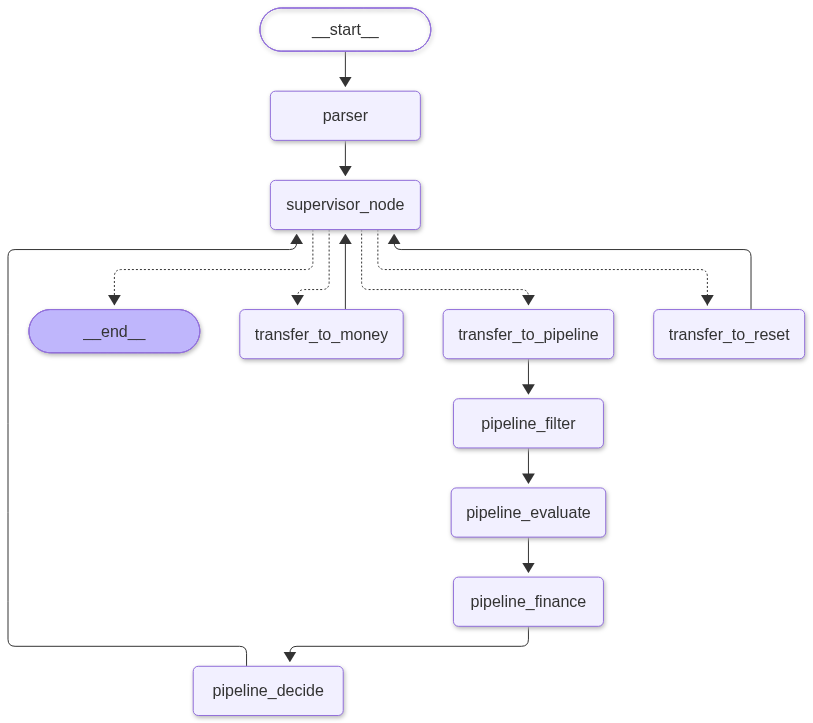

# 多智能体购物决策系统

基于 LangGraph 的购物决策助手：说一句需求，得到带理由的推荐。



## 能做什么

- **查价**：任意商品联网检索参考价（不限于本地商品库）
- **问口碑**：联网搜评测，汇总优缺点
- **帮你挑**：检索 → 硬性过滤 → 评测 → 财务核算 → 推荐

## 架构

- **LangGraph** 编排：supervisor 通过 function calling 做意图路由
- **MCP** 提供联网搜索能力（自建 MCP Server 封装 Tavily）
- **PostgreSQL Checkpointer** 实现多轮会话记忆
- **FastAPI + SSE** 流式推送每个节点的执行进度

## 快速开始

```bash
pip install -r requirements.txt   # 或按 pyproject 安装
cp .env.example .env              # 填 DEEPSEEK_API_KEY / TAVILY_API_KEY / DB_URI
python run.py                     # 打开 http://127.0.0.1:8000